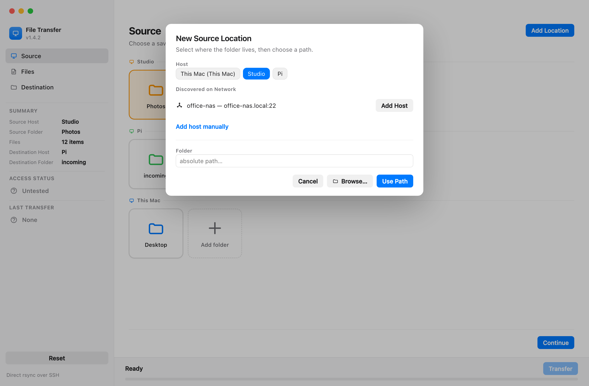
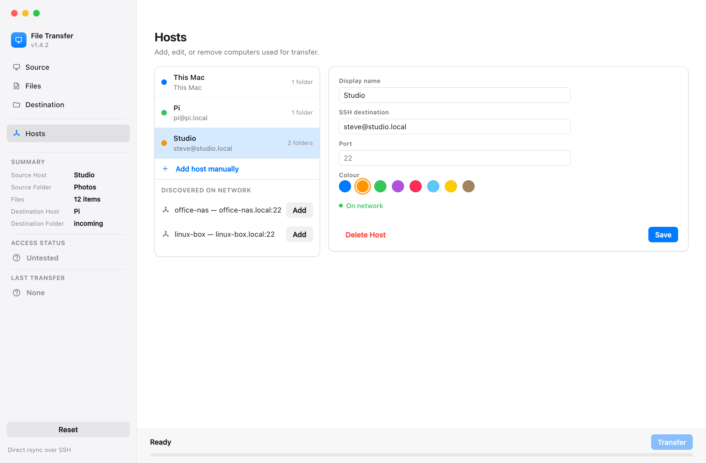
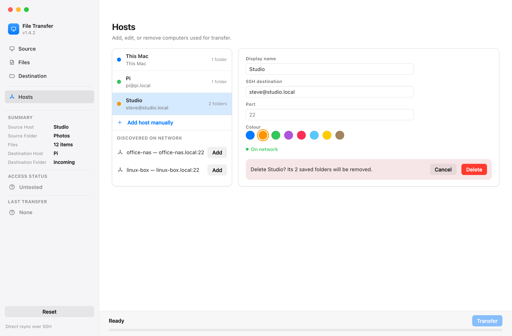
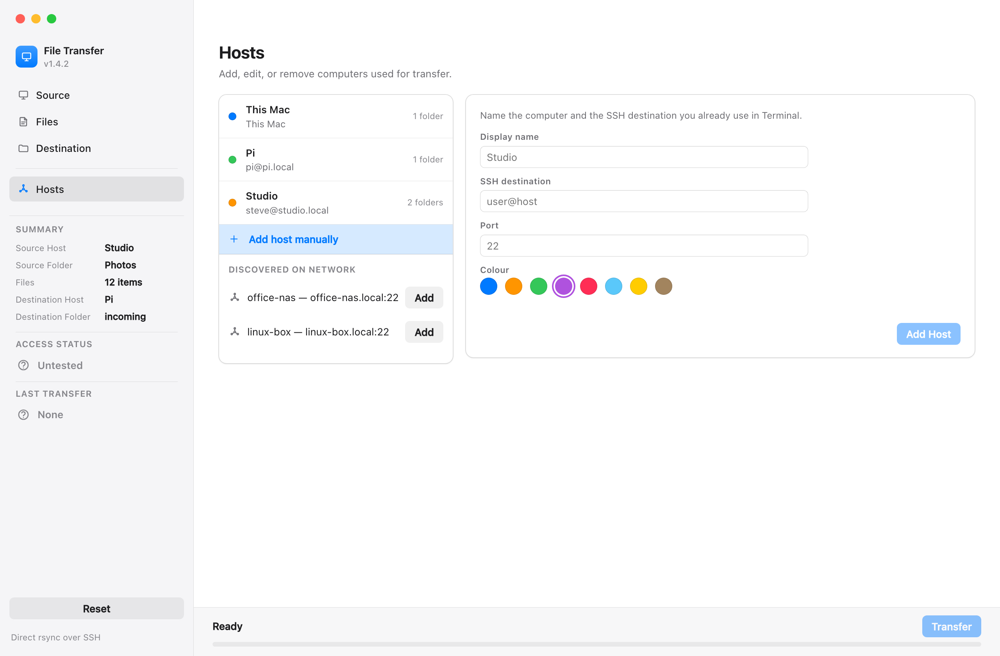
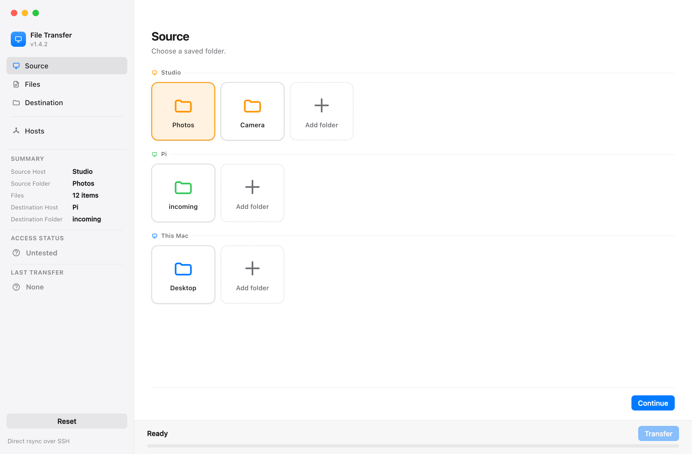

# Design: Hosts page

**Status:** Not implemented. The as-built Mac app remains [DESIGN.md](DESIGN.md). This document replaces the **Add Location** sheet with a **Hosts** page: add a computer from the network or by hand, change its name and colour, and delete it.

Mockups below use the app’s stylesheet at the window size **1280×840**. They are drawings for review, not screenshots of a build. The drawing source is [hosts/mockup.html](hosts/mockup.html).

---

## 1. Overview

Today **Add Location** is a sheet on Source and Destination. It chooses a saved host, can add one from Bonjour or from a manual form, then takes a folder path.

Saving a folder already has a home. Every saved computer, including one with no folders yet, is a host block on Source and Destination, and **Add folder** opens the in-app browser. That browser already accepts a typed path (**Go**, then **Select Folder**).

The sheet’s remaining job is the computer. That becomes a page in the main column. The sheet goes away. **Add Location** goes away with it.

```
Sidebar                         Main
Source                          Hosts
Files                           ┌ saved hosts ────────┐  ┌ editor ─────────────┐
Destination                     │ This Mac            │  │ name, SSH, port     │
────────                        │ Pi                  │  │ 8 colour swatches   │
Hosts                           │ Studio              │  │ On network          │
                                │ Add host manually   │  │ Delete Host    Save │
                                │ Discovered …   Add  │  └─────────────────────┘
                                └─────────────────────┘
```

A colour chosen here is the colour of that host’s label and folder tiles on Source and Destination.

---

## 2. Mockups

### Today: the sheet this page replaces

Opened from **Add Location** on Source. Host chips, Bonjour rows, a manual-add disclosure, then a folder path.



### Edit a host

**Hosts** is selected in the sidebar. Studio is selected in the list. The editor has the display name, SSH destination, port, and the eight colours, with orange selected. **On network** means Bonjour currently sees this computer. **Save** commits the fields. **Delete Host** starts the confirm in the next mockup. Unsaved discoveries stay in the list with **Add**.



### Delete

**Delete Host** does not remove the computer immediately. The action row becomes a confirm that names the host and how many saved folders go with it. **Cancel** returns to Save / Delete Host.



### Add manually

**Add host manually** selects an empty editor. Placeholders are hints. **Add Host** stays disabled until the name and the SSH destination are filled. The purple swatch is the first palette colour not already used by a saved host. **Add** on a discovered row saves that host immediately and selects it, so colour and name can be changed after.



### Source after the change

The header no longer has **Add Location**. Subtitle is **Choose a saved folder.** Each host keeps its colour on the label and the tiles. **Add folder** is how a path is saved. **Hosts** in the sidebar is how a computer is added or changed. The wizard footer is unchanged.



---

## 3. Goals and non-goals

### Goals

1. Add a host from Bonjour, or by typing the display name and SSH destination, as the sheet does now.
2. Change a host’s display name, SSH destination, port, and colour.
3. Delete a remote host and the folders saved on it, after a confirm that names the host and the folder count.
4. The colour chosen here is the colour of that host on Source and Destination.
5. Bonjour runs only while the Hosts page is open.

### Non-goals

- A **Test SSH** button. Reachability stays the transfer preflight.
- An identity-file field. `identity_file` stays unused, as today.
- A custom hex colour. The choice is the eight colours the tiles already use.
- Creating, renaming, or deleting folders on this page.
- Reordering hosts.
- A second sheet for the delete confirm.

---

## 4. Where the page sits

**Hosts** is a sidebar item under the wizard steps, with a hairline above it so it reads as separate from Source → Files → Destination. It is not a wizard step: there is no **Back** or **Continue** on this page.

The footer stays. Status, the progress bar, and **Transfer** remain visible, and a plan that is already ready can still be started. Switching to Hosts counts as user activity, so the five-second post-transfer reset is cancelled, the same way opening Add Location does today.

| Step | Subtitle |
|------|----------|
| Source | Choose a saved folder. |
| Files | Select files and folders to copy. |
| Destination | Choose where the files should go. |
| Hosts | Add, edit, or remove computers used for transfer. |

While preflight is running or a transfer is in progress, add, save, delete, and discovery **Add** are disabled. The page stays readable, with the line **Hosts can be changed when the transfer finishes.**

---

## 5. The page

The list and the editor sit side by side.

**Saved hosts**, This Mac first, then name. Each row:

- Colour dot (the effective colour from [§8](#8-colour))
- Display name
- Second line: **This Mac**, or the SSH destination. A non-default port is shown as `:2222`
- Folder count: **No folders**, **1 folder**, or **2 folders**

The last row is **Add host manually**. Selecting it shows the new-host editor in [§6](#6-adding-a-host).

**Discovered on network** is the bottom of the same card.

- Each unsaved SSH service is one row: service name, `host:port`, and **Add**.
- A service that matches a saved host is omitted here. The editor of that host shows **On network** instead.
- Before the first browse result: **Looking for SSH hosts…**
- After that, an empty list: **No other SSH hosts on the network.**

Selecting a saved row shows its editor. Fields that were typed for a new host and not added are discarded when the selection changes.

---

## 6. Adding a host

### From the network

**Add** saves immediately, using the same record the sheet writes today:

| Field | Value |
|-------|--------|
| Display name | Bonjour service name |
| SSH destination | Discovered hostname |
| Port | The service port, omitted when it is 22 |
| Bonjour name | Service name |
| Colour | First palette colour not already stored on a saved host, otherwise blue |

The new row is selected, so the name and colour can be changed before leaving the page.

### By hand

The editor title is the hint **Name the computer and the SSH destination you already use in Terminal.**

| Field | Rule |
|-------|------|
| Display name | Required |
| SSH destination | Required. The same string the app already passes to `ssh`: an alias, or `user@host` |
| Port | Optional. Empty means 22. A non-empty value that is not a port number blocks **Add Host** with **Port must be a number.** |
| Colour | The first palette colour not already stored, shown selected. **Add Host** stores it |

**Add Host** stays disabled until the name and the destination are non-empty.

If a saved host already has that destination and port (an empty port and 22 count as the same), **Add Host** does not insert a second row. The message is **That host is already saved.** Two hosts may share a display name. `studio` and `steve@studio.local` are different destinations and both may be saved.

---

## 7. Editing and deleting

### Remote host

Display name, SSH destination, port, and colour. **Save** is enabled when the form is valid and differs from the stored host. An empty port clears the stored port and means 22.

Saving the SSH destination does not move folders. They stay on this computer id. The next preflight uses the new destination. The stored Bonjour name is left as it is, so **On network** can still match the service after the SSH string changes.

Leaving the page discards an edit that was not saved.

### This Mac

Display name and colour only. The editor says **This Mac is always available.** There is no SSH destination, no port, and no **Delete Host**.

### Delete

**Delete Host** replaces the action row with a confirm:

- Folders saved: **Delete Studio? Its 2 saved folders will be removed.**
- None saved: **Delete Studio?**

**Cancel** restores **Delete Host** and **Save**. **Delete** removes the computer. Saved folders on it are removed with it (`locations.computer_id` is already `ON DELETE CASCADE`). The confirm uses the display name and a count. It does not name paths.

If that computer is the current source or destination, that side’s chosen folder is cleared and preflight is invalidated. A file list loaded from that source is cleared.

This Mac cannot be deleted. The store method refuses `is_local`.

---

## 8. Colour

The palette is the eight colours the app already hashes a host id into:

| | | | |
|---|---|---|---|
| `#007AFF` | `#FF9500` | `#34C759` | `#AF52DE` |
| `#FF2D55` | `#5AC8FA` | `#FFCC00` | `#A2845E` |

The selected swatch is drawn with a ring. **Save** or **Add Host** stores that hex on the computer.

Until a colour is stored, the host keeps today’s colour: the palette entry chosen from the id. Opening the editor shows that derived colour as selected. Saving pins it, so a later edit of the name does not depend on the hash. A stored value outside the palette is ignored and the hash is used.

Source and Destination read the stored colour for the host label and the tile borders. A change shows up on the next visit to those steps.

---

## 9. Discovery

`ft-mdns` browses `_ssh._tcp` only while Hosts is visible, and the browser shuts down when the page is left. That is the same lifetime as the Add Location sheet. While the page is visible the list refreshes about twice a second, as the sheet does today.

A discovery matches a saved host when either:

- the saved Bonjour name equals the service name, or
- the host part of the SSH destination equals the discovered host, and the ports agree.

The host part is the destination with an optional `user@` removed and a trailing `.` or `.local` removed. The same stripping applies to the discovered host. A missing port and port 22 agree.

**On network** is that live match. It is not a stored flag, and it is not a reachability test.

---

## 10. Store

`computers` gains `color TEXT`, nullable, added with `ALTER TABLE`. `NULL` means the colour is still derived from the id, so existing databases keep their current colours until a host is saved from this page.

`upsert` writes `color` with the other computer columns.

`delete_computer` deletes one row where `is_local = 0`. Folders follow by the existing cascade.

---

## 11. What stays as it is

- The folder browser sheet, including **New Folder** on a destination browse.
- **Add folder** on a host block, tile drag-reorder, and tile delete.
- A typed path through the browser’s path field and **Go**.
- Preflight, **Transfer**, the summary sidebar, and the post-transfer reset.
- No in-app SSH test.

---

## 12. Review points

These are the choices the mockups assume. Each one is local and can change without redrawing the rest of the page.

| Topic | In these mockups | Easy alternative |
|-------|------------------|------------------|
| Entry | Sidebar **Hosts**. **Add Location** is removed | Keep a header button on Source and Destination that only switches to this page |
| Discovery **Add** | Saves immediately, then selects the new host | Open the new-host form prefilled, and require **Add Host** |
| Colour | The existing eight swatches | A colour well, or “automatic” as a ninth choice that clears the stored colour |
| Save | Explicit **Save**. Leaving the page drops unsaved edits | Write each field when it loses focus |
| Delete | Inline confirm in the editor | A small sheet |
| This Mac | Name and colour can change. It cannot be deleted | Colour only, name fixed to the Mac’s sharing name |
| Footer on Hosts | Stays, so a ready transfer is still one click away | Hide the footer on this page |
| Typed folder path | Stays in the folder browser | Also offer a path field on the host block |
